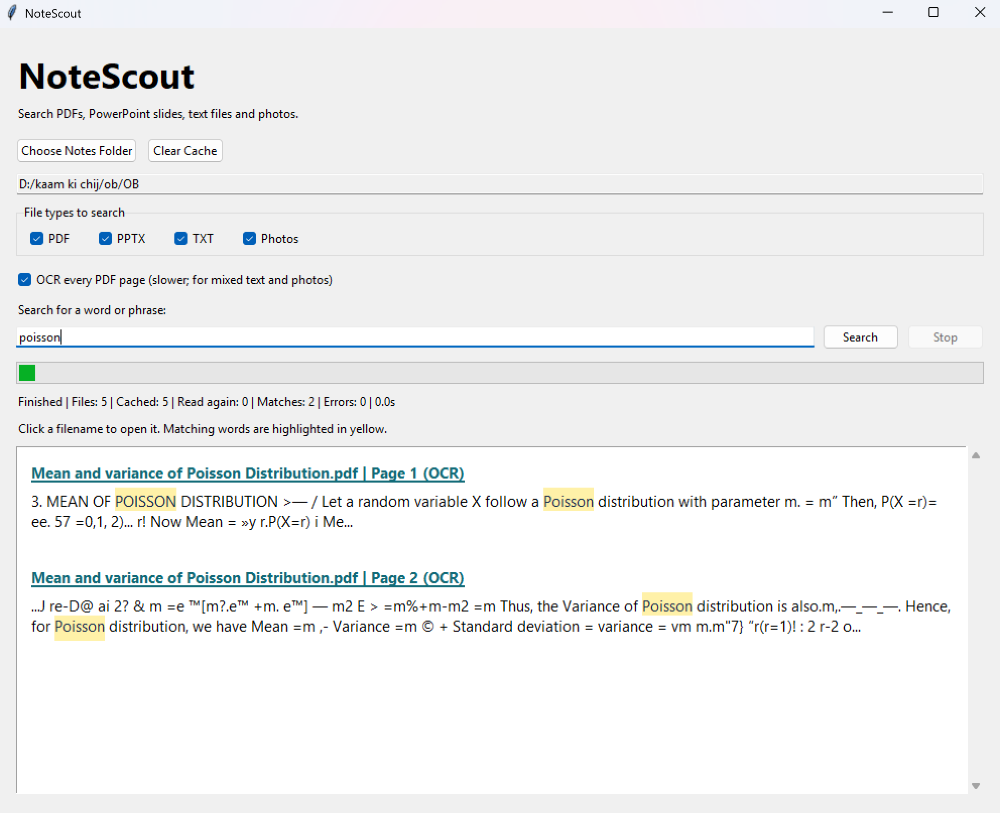

# 🔎 NoteScout

A document search tool with two ways to use it: a website for searching uploaded documents from your browser, and a Windows desktop app for searching folders on your computer.

**[Use NoteScout online](https://notescout-web-harshit.cuddlypanel1.chatgpt.site)** · **[Download NoteScout for Windows](https://github.com/harshitattri/NoteScout/releases/tag/v1.0)**

## About the Project

I built NoteScout to solve a simple problem: finding specific information across multiple documents can take a lot of time, especially when you have to open each file individually.

With NoteScout, you can select a folder, enter a word or phrase, and search through the supported files in one place.

It also supports OCR (Optical Character Recognition), which makes it possible to search for text inside scanned PDFs and images.

The goal was to build something practical that could be useful for students, researchers, and anyone who regularly works with documents.

## Choose Your Version

### NoteScout Web

Open **[NoteScout Web](https://notescout-web-harshit.cuddlypanel1.chatgpt.site)** in a browser on a phone, Mac, or Windows computer. Upload the documents you want to search without installing the desktop application.

### NoteScout for Windows

Download **[NoteScout v1.0 for Windows](https://github.com/harshitattri/NoteScout/releases/tag/v1.0)**. Select folders directly from your PC and search supported files locally without uploading them to the website. The desktop app only searches locations you select; it doesn't automatically access your entire computer.

## Windows App Features

- **Search multiple file formats:** Supports PDF, PPTX, TXT, and image files.
- **OCR support:** Finds text inside scanned documents and images.
- **Keyword search:** Search for a specific word or phrase across files.
- **Highlighted matches:** Search terms are highlighted in yellow, making them easier to spot.
- **Page numbers:** Shows which PDF page contains the matching text.
- **Faster repeated searches:** Uses caching to avoid processing unchanged files again.
- **Open files directly:** Click a result to open the original document.
- **Search progress:** Displays the number of files processed, matches found, and errors.
- **File type selection:** Choose which types of files to include in a search.
- **Clear cache:** Remove stored search data whenever needed.

## How to Use the Windows App

1. Open NoteScout.
2. Click **Choose Notes Folder** and select the folder you want to search.
3. Select the file types you want to include.
4. Enable OCR if you're searching scanned PDFs.
5. Enter the word or phrase you're looking for.
6. Click **Search**.
7. Browse the results and click a filename to open the original file.

## Windows App Technologies Used

- Python
- Tkinter for the desktop interface
- OCR for extracting text from scanned documents and images
- Document text extraction
- File caching for faster repeated searches
- PyInstaller for creating the Windows application

## Installation

### For Windows Users

You can use the packaged version of NoteScout without installing Python.

1. Go to the **Releases** section of this repository.
2. Download the latest NoteScout ZIP file.
3. Extract the downloaded ZIP.
4. Open the extracted folder.
5. Double-click `NoteScout.exe` to launch the application.

**Current Windows release:** [NoteScout v1.0](https://github.com/harshitattri/NoteScout/releases/tag/v1.0) — download `NoteScout-Windows-v1.0.zip` under **Assets**. Extract the complete application folder before running `NoteScout.exe`.

### For Developers

The Python source code is available in this repository.

You can download or clone the project and run `notescout.py` after installing the required Python dependencies.

## Who Can Use NoteScout?

I think NoteScout can be particularly useful for:

- Students searching through lecture notes and assignments.
- Researchers working with multiple PDF documents.
- Professionals looking for information in reports.
- Anyone who has a large collection of documents and wants to find information quickly.

## Screenshots

## Future Improvements

There are still a few things I'd like to improve as I continue working on this project:

- Add more advanced search filters.
- Allow users to export search results.
- Improve the interface and overall user experience.
- Support additional document formats.
- Continue improving OCR accuracy and search performance.

## What I Learned

Working on NoteScout helped me understand how different parts of a Python application come together.

I got hands-on experience with building a desktop interface, extracting information from different file formats, implementing OCR, and using caching to improve performance.

I also learned how to package a Python project into a Windows executable so it can be used without running the source code manually.

This project was a good opportunity to work on something beyond basic programming exercises and build an application that solves a practical problem.

## License

This project is available under the MIT License.

You're welcome to use, modify, or improve the code while following the license terms.

## Author

**Harshit Attri**

B.Tech Computer Science Engineering Student

Interested in Python, software development, and building practical tools that solve everyday problems.
